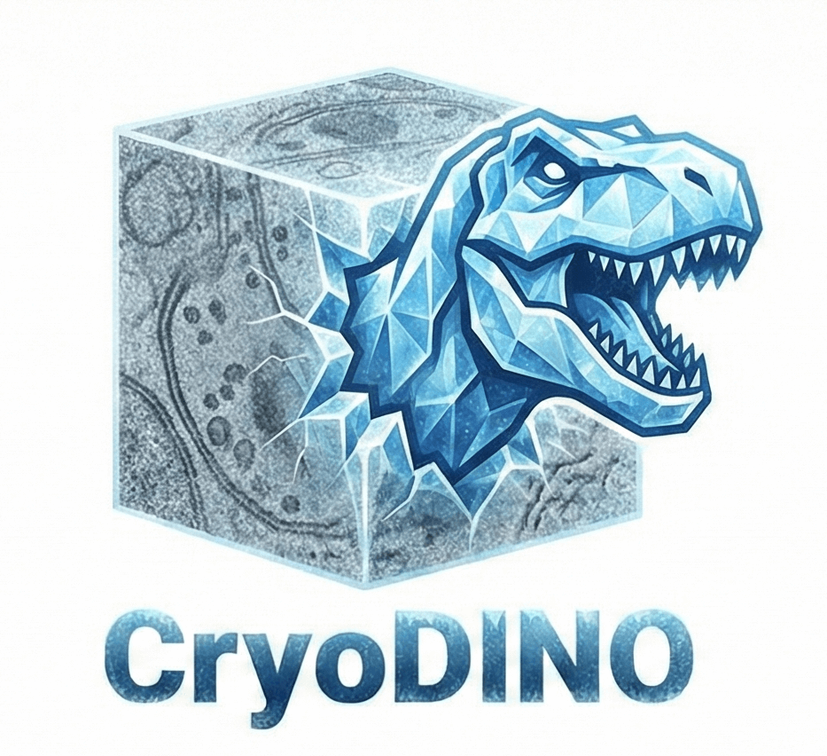
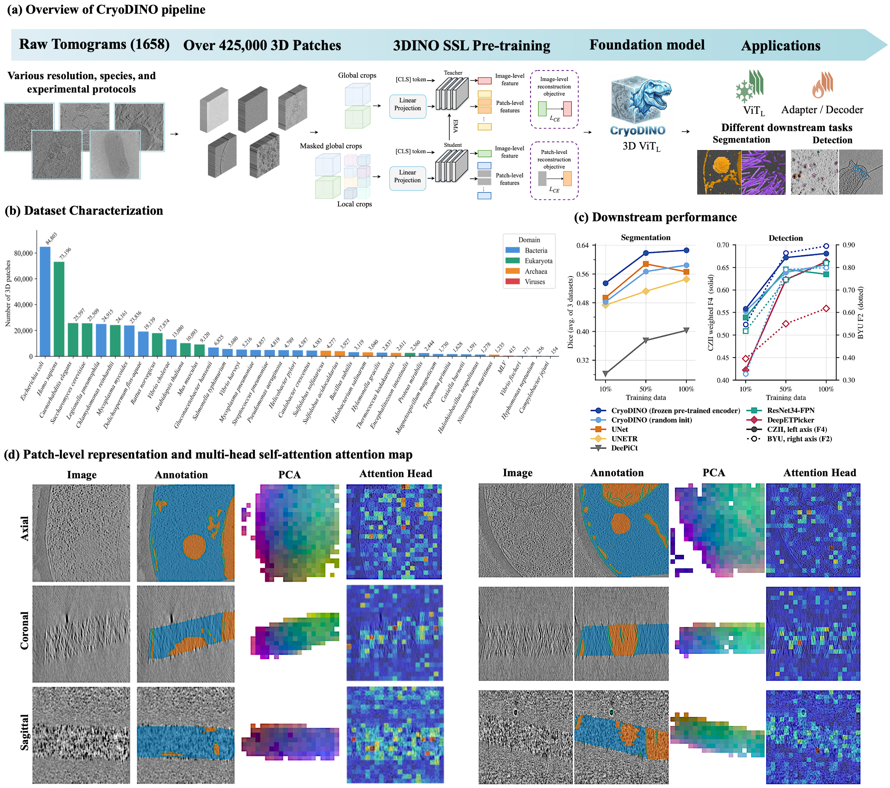

# CryoDINO: A generalizable 3D foundation model for cryo-electron tomography



Ahmadreza Attarpour<sup>\*†</sup>,
Sumin Kim<sup>\*†</sup>,
Tony Xu,
Charles Chen,
Daphne Baron,
Ching-Yuan Yu,
Yeonwoo Seo,
Baidu Li,
Elnaz Khalili Samani,
Mohammad T. Mazhab-Jafari,
Maged Goubran,
Barry B. Rubin,
Jun Ma,
Bo Wang<sup>†</sup>

<sup>\*</sup> Equal contribution &nbsp; <sup>†</sup> Corresponding authors

[Project Page](https://cryodino.github.io/) | [Preprint](https://arxiv.org/abs/XXXX.XXXXX) | [HF Weights](https://huggingface.co/XXXX/CryoDINO)

This codebase contains the PyTorch code for pretraining CryoDINO, a 3D ViT-Large trained with the [3DINO](https://github.com/AICONSlab/3DINO) self-supervised framework on cryo-ET tomograms, and for transferring it to 3D segmentation and particle detection.

**Abstract:** Nanometre-resolution images acquired with cryogenic electron tomography (cryo-ET) provide unprecedented insights into sub-cellular architecture and the 3D spatial organization of macromolecules in their native environment. Yet, there remains an unmet need for computational pipelines that generalize across experimental conditions and downstream tasks while remaining robust to extremely low signal-to-noise ratios and reconstruction artifacts. We present CryoDINO, a general-purpose foundation model for cryo-ET, pretrained using teacher-student self-distillation self-supervised learning on a corpus of 1,658 tomograms and 425,852 3D patches spanning 37 species and experimental conditions. CryoDINO learns transferable 3D representations that encode explicit semantic information about macromolecular identity and spatial organization. A shared pretrained backbone, coupled with task-specific decoders, enables both semantic segmentation and particle detection. Validation against state-of-the-art task-specific methods on multiple semantic-segmentation and particle-detection benchmarks demonstrated CryoDINO’s high generalizability and performance. CryoDINO establishes a scalable and transferable representation backbone for generalizable computational pipelines in structural biology.

<p align="center">
  
</p>

**Key facts:**
- Pretrained on **425,000+ 3D patches** from **1,658 tomograms**, spanning bacteria, eukaryota, archaea, and viruses
- ViT-Large backbone with 16³ patch tokenization (1024-dim, 24 blocks)
- Three SSL objectives: **DINO** (view consistency) + **iBOT** (masked patch prediction) + **KoLeo** (diversity)
- Two-stage pretraining: standard 96³ crops → high-resolution 128³ adaptation
- With a **frozen encoder**, CryoDINO reaches segmentation Dice 0.626 (average of three datasets) and CZII detection F4 0.681 with all labels, and already beats the best baseline trained on all labels with only **50% of them** (0.619 vs 0.585 and 0.672 vs 0.663). For detection, CryoDINO is the frozen encoder with the `adapter_fpn` decoder, lr 1e-3 and gradient clipping 3.0

---

## Table of Contents

1. [Pipeline Overview](#pipeline-overview)
2. [Installation](#installation)
3. [Pretraining](#pretraining)
4. [Segmentation Fine-tuning](#segmentation-fine-tuning)
   - [Downstream Patch Generation](#downstream-patch-generation)
   - [Configuration](#configuration)
   - [Sample Fine-tuning Script](#sample-fine-tuning-script-slurm)
5. [Detection Fine-tuning](#detection-fine-tuning)
6. [Inference](#inference)
7. [Baselines](#baselines)
   - [Segmentation baselines](#segmentation-baselines)
   - [Detection baselines](#detection-baselines)
   - [Inference-only baselines (MemBrain-seg / DeePiCt)](#inference-only-baselines-membrain-seg--deepict)
8. [Visualization](#visualization)
9. [License](#license)
10. [Citation](#citation)

---

## Pipeline Overview

```
Raw CryoET Tomograms (.nii / .nii.gz)
         │
         ▼
preprocessing/subtomograms_generation.py
  → Non-overlapping 128³ patches (.pt), Otsu foreground filtering
         │
         ▼
preprocessing/create_pretrain_json.py
  → pretrain.json  (image path + spacing metadata)
         │
         ▼
[Pretraining — done, checkpoints available below]
  3DINO/dinov2/train/train3d.py
  Stage 1: 125,000 iters @ 96³ crops          (4× B200)
  Stage 2: 12,500 iters  @ 128³ crops         (high-res adaptation, 4× B200)
         │
         ├───────────────────────────────┐
         ▼                               ▼
  Segmentation                    Detection (CZII particles)
preprocessing/                  preprocessing/
downstream_patch_generation.py  downstream_patch_generation.py --detection
  → image+label 512³ patches      → image + point-label 128³ patches
         │                               │
         ▼                               ▼
3DINO/dinov2/eval/              3DINO/dinov2/eval/detection3d.py
segmentation3d.py                 → ViT-Adapter + UNETR decoder +
  → ViT-Adapter + UNETR decoder     dense detection head
         │                               │
         ▼                               ▼
inference/                      detection3d.py --save-test-predictions
segmentation3d_inference.py       → particle coordinates; test F4 at
  → predicted masks (.nii.gz)       validation-selected thresholds
```

---

## Installation

**Requirements:** Python 3.9, CUDA 12.1, conda

**Option A — conda (recommended, exact environment)**

```bash
git clone https://github.com/<your-org>/CryoDINO.git
cd CryoDINO

# The prefix line in environment.yml is cluster-specific — conda will ignore it
# and install into your default envs directory
conda env create -f environment.yml
conda activate cryoet
```

**Option B — pip into an existing Python 3.9 environment**

```bash
pip install -r requirements.txt
```

**Option C — B200 GPUs (`cryodino` environment)**

The `cryoet` environment above (`torch 2.1 + cu121`) has no kernels for B200 (sm_100) GPUs. The B200 pretraining and fine-tuning runs use a separate environment (Python 3.11, `torch 2.9.1 + cu130`):

```bash
conda env create -f environment_cryodino.yml
conda activate cryodino
pip install -r requirements_cryodino.txt
```

> **Note:** `requirements.txt` and `environment.yml` reflect the environment used for the H100/A100 experiments (`torch==2.1.0+cu121`, `xformers==0.0.22.post4`, `monai==1.3.0`); `environment_cryodino.yml` and `requirements_cryodino.txt` reflect the B200 environment. Using different versions may require adjustments.

> **GPU memory:** Pretraining was run on 4× B200 (183 GB each); the earlier runs used 4× H100-80GB. Fine-tuning and inference run on a single GPU (200 GB RAM recommended).

---

## Pretraining

> Pretraining is already done. Download the checkpoints below and proceed to [Segmentation Fine-tuning](#segmentation-fine-tuning) or [Detection Fine-tuning](#detection-fine-tuning).

### What we used

**Data.** 1,658 raw CryoET tomograms (bacteria, eukaryota, archaea, viruses) were collected from public repositories including CZII and EMPIAR. Each tomogram was split into non-overlapping **128³ voxel patches** using `preprocessing/subtomograms_generation.py`, which applies Otsu thresholding to discard empty background patches. 425,852 patches were retained across all datasets. A JSON manifest was then generated with `preprocessing/create_pretrain_json.py` to supply file paths and voxel spacing to the data loader.

**Input normalization.** During pretraining each crop is normalized with one of two schemes, chosen with equal probability: a percentile clip to [-1, 1] (one of the pairs 2–98, 1–99, 0.5–99.5, 0.05–99.95, 0.02–99.98) or a z-score with a random clip of k standard deviations (k = 1–5), also scaled to [-1, 1]. See `3DINO/dinov2/train/train3d.py`.

**Model.** A 3D Vision Transformer (ViT-Large) with 16³ patch tokenization, 24 transformer blocks, and 1024-dim embeddings. Memory-efficient attention is provided by [xFormers](https://github.com/facebookresearch/xformers).

**Training.** Two-stage self-supervised pretraining using DINO + iBOT + KoLeo losses:

| Stage | Config | Crops | Iterations | Hardware |
|-------|--------|-------|-----------|----------|
| 1 — Standard | `3DINO/dinov2/configs/ssl3d_default_config.yaml` | 96³ global, 48³ local ×8 | 125,000 | 4× B200 |
| 2 — High-res | `3DINO/dinov2/configs/train/vit3d_highres.yaml` | 128³ global, 64³ local ×8 | 12,500 | 4× B200 |

Stage 2 is initialized from the Stage 1 teacher checkpoint and adapts the model to higher-resolution inputs. Batch sizes, learning rates and all other hyperparameters are in the two YAML files. The launch script is `slurm_scripts/pretrain_3dino_slurm.sh`.

### Checkpoints

| Checkpoint | Stage | Iterations | Notes |
|------------|-------|-----------|-------|
| `teacher_checkpoint_stage1.pth` | 1 | 112,499 | Standard 96³ pretraining |
| `teacher_checkpoint_stage2.pth` | 2 | 6,249 | High-res 128³ adaptation **(recommended)** |

> **Download:** _[Link coming soon — checkpoints will be hosted on Zenodo / HuggingFace Hub]_

Place downloaded checkpoints under:
```
experiments/
├── ssl3d_run_b200/eval/training_112499/teacher_checkpoint.pth             # stage 1
└── ssl3d_run_b200_high_res_128/eval/training_6249/teacher_checkpoint.pth  # stage 2 (recommended)
```

---

## Segmentation Fine-tuning

The backbone is **frozen** by default and only the adapter and decoder are trained (add `--train-feature-model` to fine-tune everything).

### Downstream Patch Generation

For fine-tuning, tomograms are split into **512³ voxel patches** (larger than pretraining to preserve spatial context for the segmentation decoder). Only patches with at least 1% foreground label voxels are kept.

```bash
# Percentile normalization [0.5–99.5] → [-1, 1]  (default)
python preprocessing/downstream_patch_generation.py \
    --datalist-json /path/to/Dataset001_100_datalist.json \
    --output-dir    /path/to/Dataset001_patches512/ \
    --patch-size    512

# Z-score normalization
python preprocessing/downstream_patch_generation.py \
    --datalist-json /path/to/Dataset001_100_datalist.json \
    --output-dir    /path/to/Dataset001_patches512/ \
    --patch-size    512 \
    --zscore

# Different XY and Z patch sizes (e.g. for anisotropic volumes)
python preprocessing/downstream_patch_generation.py \
    --datalist-json /path/to/Dataset001_100_datalist.json \
    --output-dir    /path/to/Dataset001_patches512/ \
    --patch-size    512 --patch-size-z 128 \
    --fg-threshold  0.01
```

The input `datalist.json` must follow the structure:
```json
{
  "training":   [{"image": "...", "label": "..."}],
  "validation": [{"image": "...", "label": "..."}],
  "test":       [{"image": "...", "label": "..."}]
}
```

**Output:**
```
Dataset001_patches512/
├── images/   # <name>_patch_<x>_<y>_<z>.pt
├── labels/   # matching label patches
└── Dataset001_patches_100_datalist.json
```

---

### Configuration

Fine-tuning uses the high-resolution config (`3DINO/dinov2/configs/train/vit3d_highres.yaml`) as the backbone config, then passes segmentation-specific arguments via CLI:

```yaml
# vit3d_highres.yaml — used as backbone config for fine-tuning
student:
  full_pretrained_weights: '/path/to/stage1/teacher_checkpoint.pth'
crops:
  global_crops_size: 112
  local_crops_size: 64
train:
  batch_size_per_gpu: 64
  OFFICIAL_EPOCH_LENGTH: 125
optim:
  base_lr: 0.001
```

**Segmentation head options:**
- `Linear` — single linear layer on frozen ViT [CLS] token
- `UNETR` — U-shaped decoder with frozen ViT encoder
- `ViTAdapterUNETR` — spatial adapter modules injected into ViT + UNETR decoder **(recommended and tested)**

Add `--train-feature-model` to unfreeze the ViT backbone for full fine-tuning.

---

### Sample Fine-tuning Script (SLURM)

```bash
#!/bin/bash
#SBATCH -J cryodino-finetune
#SBATCH --nodes=1
#SBATCH --gres=gpu:1
#SBATCH --cpus-per-task=24
#SBATCH --mem=200G
#SBATCH -t 6-00:00:00

source ~/.bashrc
conda activate cryodino

cd /path/to/CryoDINO/3DINO || exit 1

CONFIG_FILE="dinov2/configs/train/vit3d_highres.yaml"
PRETRAINED_WEIGHTS="/path/to/teacher_checkpoint.pth"
OUTPUT_DIR="/path/to/experiments/finetuning/Dataset001_ViTAdapterUNETR"
DATASET_NAME="Dataset001_CZII_10001_patches512"
BASE_DATA_DIR="/path/to/experiments"
CACHE_DIR="/path/to/cache"

mkdir -p "$OUTPUT_DIR" "$CACHE_DIR"

OMP_NUM_THREADS=1 MKL_NUM_THREADS=1 NUMEXPR_NUM_THREADS=1 \
PYTHONPATH=. python dinov2/eval/segmentation3d.py \
  --config-file        "$CONFIG_FILE" \
  --output-dir         "$OUTPUT_DIR" \
  --pretrained-weights "$PRETRAINED_WEIGHTS" \
  --dataset-name       "$DATASET_NAME" \
  --dataset-percent    100 \
  --base-data-dir      "$BASE_DATA_DIR" \
  --segmentation-head  ViTAdapterUNETR \
  --epochs             100 \
  --epoch-length       300 \
  --eval-iters         600 \
  --warmup-iters       3000 \
  --image-size         128 \
  --batch-size         2 \
  --num-workers        10 \
  --learning-rate      1e-4 \
  --cache-dir          "$CACHE_DIR" \
  --resize-scale       1.0
```

The runs reported in the paper are launched with `slurm_scripts/train_segmentation.sh` (one dataset per job, training followed by test-set inference) and submitted with `slurm_scripts/submit_segmentation.sh`, which sets memory and time per run:

```bash
# PRESET: h100_9374 | b200_112 | b200_128 | b200_best | b200_best_full | random_init (see the script header)
bash slurm_scripts/submit_segmentation.sh b200_best "001 010 989 049" "50 10"            # print the sbatch commands
bash slurm_scripts/submit_segmentation.sh b200_best "001 010 989 049" "50 10" --submit   # submit them
```

---

## Detection Fine-tuning

Particle detection on the CZII benchmark (`Dataset440_CZII_10440`, six classes: Beta-amylase, Beta-galactosidase, Thyroglobulin, cytosolic ribosome, ferritin complex, virus-like capsid). The model is the frozen CryoDINO ViT with a ViT-Adapter, a UNETR decoder and a dense stride-2 detection head (class and offset branches). All methods are trained with the same loss, assigner and NMS decoding (`3DINO/dinov2/eval/detection3d.py`), so only the backbone differs.

**Metric.** CZII weighted F4 (class weights 0/2/2/1/1/1 in class-id order, so Beta-amylase does not count), with a match radius of 0.5 × the particle radius. A score threshold is chosen **per class on the validation set** (at the best validation checkpoint) and applied unchanged to the test set.

### Detection patch generation

`downstream_patch_generation.py` runs in `--detection` mode: it reads the CSV point annotations and writes overlapping 128³ patches with their point labels and a datalist. Validation and test entries keep the whole-tomogram NIfTI paths with global point labels.

```bash
python preprocessing/downstream_patch_generation.py \
    --datalist-json /path/to/czi_split_datalist.json \
    --csv           /path/to/Dataset440_CZII_10440/point_annotations.csv \
    --output-dir    /path/to/detection_patches \
    --output-json   /path/to/czi_100_datalist.json \
    --detection --zscore --patch-size 128 \
    --sigmas-ang '{"Beta-amylase":65,"Beta-galactosidase":90,"Thyroglobulin":130,"cytosolic ribosome":150,"ferritin complex":60,"virus-like capsid":135}'
```

The 10% and 50% training subsets are separate datalists (`czi_10percent/`, `czi_50percent/`); validation and test are identical for every size. `preprocessing/balance_detection_patches.py` balances foreground and background training patches (used for BYU).

### Training

```bash
cd 3DINO
PYTHONPATH=. python dinov2/eval/detection3d.py \
  --config-file        dinov2/configs/train/vit3d_highres.yaml \
  --output-dir         /path/to/finetuning_detection/cryodino_czi_100pct \
  --pretrained-weights /path/to/teacher_checkpoint.pth \
  --dataset-name       czi \
  --dataset-percent    100 \
  --base-data-dir      /path/to/detection_patches \
  --segmentation-head  ViTAdapterUNETR \
  --epochs 100 --epoch-length 300 --eval-iters 1200 --warmup-iters 3000 \
  --image-size 128 --batch-size 4 --num-workers 8 --learning-rate 1e-4 \
  --cache-dir          /path/to/cache
```

The detection SLURM scripts (`slurm_scripts/train_detection.sh`, `train_detection_hyp.sh`, `test_dump_detection.sh`; `submit_detection.sh` submits them) run one (method, dataset, percentage) combination each (edit the cluster paths at the top before submitting). Submit them with `--export=ALL,METHOD=...,DATASET=czi,PERCENT=...`; the exact commands for every run are listed in [`DETECTION.md`](DETECTION.md).

| `METHOD` | Model |
|---|---|
| `cryodino` | frozen CryoDINO + ViT-Adapter / UNETR |
| `cryodino_last1` | same, last ViT block unfrozen (`--train-last-n-blocks 1`) |
| `cryodino_ft` | same, full fine-tuning (`--train-feature-model`) |
| `random_init` | same architecture, no pre-training (`--train-feature-model`) |
| `resnetfpn` | ResNet34-FPN from scratch (`--segmentation-head ResNetFPN`) |

`train_detection_hyp.sh` runs the variants of the frozen model, including the one reported as **CryoDINO** for detection: **frozen encoder + `adapter_fpn`, lr 1e-3, gradient clipping 3.0**.

```bash
sbatch --export=ALL,METHOD=cryodino,DATASET=czi,PERCENT=100,DECODER_FUSION=adapter_fpn,LEARNING_RATE=1e-3,CLIP_GRAD=3.0 \
    slurm_scripts/train_detection_hyp.sh
# equivalent flags of detection3d.py: --decoder-fusion adapter_fpn --learning-rate 1e-3 --clip-grad 3.0
```

`adapter_fpn` adds a small FPN-style top-down path, initialised at zero, over the UNETR skip connections, so training starts identical to the plain frozen model. Other options of this script are `--lora-rank 16` (LoRA on the attention layers of the frozen ViT) and a different `--learning-rate`.

> The comparison methods are trained with their default recipes: `random_init` and `resnetfpn` use lr 1e-4 without gradient clipping, and DeepETPicker uses its own settings (see [Detection baselines](#detection-baselines)). Plain frozen CryoDINO (lr 1e-4, no `adapter_fpn`) is also available as `METHOD=cryodino`.

### Outputs and predictions

Each run directory holds `best_model.pth` and `results.json` (`test_f4`, `test_per_cls_f4`, `best_val_f4` and `best_val_thresholds`). Add `--save-test-predictions` to also write the decoded test detections (`test_predictions.pkl` / `.csv`). `3DINO/dinov2/eval/detection3d_test_dump.py` (`slurm_scripts/test_dump_detection.sh`) dumps predictions from a trained model, and `utils/verify_test_predictions.py` checks them.

---

## Inference

Run sliding-window inference on new tomograms using a pretrained backbone and fine-tuned segmentation head.

**Mode 1: JSON datalist (uses `test` split)**
```bash
python inference/segmentation3d_inference.py \
    --config-file        3DINO/dinov2/configs/train/vit3d_highres.yaml \
    --pretrained-weights /path/to/teacher_checkpoint.pth \
    --checkpoint         /path/to/finetuning/Dataset001_ViTAdapterUNETR/best_model.pth \
    --segmentation-head  ViTAdapterUNETR \
    --image-size         128 \
    --num-classes        4 \
    --datalist           /path/to/Dataset001_100_datalist.json \
    --output-dir         /path/to/inference_output/ \
    --overlap            0.75 \
    --batch-size         1
```

**Mode 2: Directory of NIfTI files**
```bash
python inference/segmentation3d_inference.py \
    --config-file        3DINO/dinov2/configs/train/vit3d_highres.yaml \
    --pretrained-weights /path/to/teacher_checkpoint.pth \
    --checkpoint         /path/to/best_model.pth \
    --segmentation-head  ViTAdapterUNETR \
    --image-size         128 \
    --num-classes        4 \
    --input-dir          /path/to/tomograms/ \
    --label-dir          /path/to/labels/ \
    --output-dir         /path/to/inference_output/
```

> `--label-dir` is optional. When provided, per-image and mean Dice scores are computed and saved to `metrics.json`.

**Outputs:**
```
inference_output/
├── <tomogram_name>.nii.gz   # predicted segmentation mask (uint8)
└── metrics.json             # per-image and mean Dice scores (if labels provided)
```

---

## Baselines

CryoDINO is compared with the following baselines. Every baseline is trained and evaluated on the same patches, splits and metrics as CryoDINO. Each baseline's kit has its own README.

| Baseline | Task | Training | Inference / scoring |
|---|---|---|---|
| UNet, UNETR (MONAI, from scratch) | segmentation | `baselines/unet_unetr/train.py` | `baselines/unet_unetr/inference.py` |
| CryoDINO random init (same ViT-Adapter + UNETR, no pre-training) | segmentation | `slurm_scripts/train_segmentation.sh` with `PRESET=random_init` | `inference/segmentation3d_inference.py` |
| DeePiCt | segmentation | `baselines/deepict/` | `baselines/deepict_inference.py` |
| MemBrain-seg (membrane class only) | segmentation | `baselines/membrain_kit/` | `baselines/membrain_inference.py` |
| ResNet34-FPN (from scratch) | detection | `detection3d.py --segmentation-head ResNetFPN` | `detection3d.py` |
| CryoDINO random init | detection | `slurm_scripts/train_detection.sh` with `METHOD=random_init` | `detection3d.py` |
| DeepETPicker | detection | `baselines/deepetpicker_kit/` | `baselines/deepetpicker_kit/evaluate_czi.py` |

### Segmentation baselines

**UNet / UNETR** are MONAI models trained from random initialization. They read the same `*_patches512` datasets as CryoDINO fine-tuning. Run from `3DINO/`:

```bash
cd 3DINO
OMP_NUM_THREADS=1 PYTHONPATH=. python ../baselines/unet_unetr/train.py \
    --model_name   unet \                 # or unetr
    --dataset_name Dataset001_CZII_10001_patches512 \
    --base_data_dir /path/to/experiments \
    --output_dir   /path/to/experiments/baselines/unet_Dataset001 \
    --cache_dir    /path/to/cache \
    --image_size   112 \
    --dataset_percent 100
```

`slurm_scripts/train_baselines.sh` trains and evaluates one model on one dataset (`MODEL`, `DATASET`, `PERCENT`); `bash slurm_scripts/submit_segmentation.sh baselines "" "100 50 10"` submits all of them.

**CryoDINO random init** uses the same fine-tuning pipeline as CryoDINO with no pre-trained weights (`--pretrained-weights ""`) and a trainable backbone: `slurm_scripts/train_segmentation.sh` with `PRESET=random_init`.

**DeePiCt** and **MemBrain-seg** are trained with their own kits, `baselines/deepict/` and `baselines/membrain_kit/` (see their READMEs; `run_datalist.sh` drives the full pipeline from a datalist, and `baselines/submit_deepict.sbatch` / `submit_membrain.sbatch` run one dataset per job: `sbatch --export=ALL,DATASET=001,PERCENT=100 baselines/submit_deepict.sbatch`). MemBrain-seg is binary, so it is only evaluated on the membrane class.

### Detection baselines

- **ResNet34-FPN** (from scratch) shares everything with CryoDINO except the backbone: the same loss, assigner, NMS decoding and detection head (`ResNetFPNHead`). Run it with `METHOD=resnetfpn` in `slurm_scripts/train_detection.sh`.
- **CryoDINO random init** uses the same architecture as CryoDINO with random weights and a trainable backbone (`METHOD=random_init`).
- **DeepETPicker** (3D ResUNet particle picker) is trained with `baselines/deepetpicker_kit/` on CZI and BYU (`setup.sh` once, then `PERCENT=<100|50|10> bash slurm_scripts/deepetpicker_{czi,byu}.sh` from the login node). It follows the same protocol as `detection3d.py`: 30k iterations at batch 4, a checkpoint every 1,500 iterations chosen on the full validation split, and test scored at the val-chosen thresholds with CryoDINO's own metric code (`evaluate_czi.py` loads `detection_3d/metrics.py`), so its F4 / F2 is directly comparable. Its README documents the protocol, the data conversion and the patches applied to the upstream code.
- `baselines/detection3d_monai/` is an exploratory MONAI RetinaNet baseline. It trains with MONAI's own anchor-based loss, so it is not a same-loss comparison and is not part of the benchmark.

### Inference-only baselines (MemBrain-seg / DeePiCt)

Two baselines can be evaluated through the same interface, so their numbers drop straight into the
same results table. Both are **inference only** — training lives in the separate `membrain_kit/`
and `deepict/` pipelines — and both accept the same `--datalist` / `--input-dir` + `--label-dir`
input modes as `segmentation3d_inference.py`.

> These scripts do **not** import `3DINO/`. Run them in the venv that has `membrain_seg` and the
> DeePiCt dependencies, *not* the `cryoet` conda env:
> ```bash
> module load python/3.11 && source /path/to/venvs/membrain/bin/activate
> ```

**MemBrain-seg** ([teamtomo/membrain-seg](https://github.com/teamtomo/membrain-seg)):
```bash
python baselines/membrain_inference.py \
    --checkpoint  /path/to/membrain_binary-<best>.ckpt \
    --datalist    /path/to/datalist.json \
    --output-dir  /path/to/membrain_inference/ \
    --sw-roi-size 160          # multiple of 32; lower it if the GPU is tight
```
Add `--no-tta` to skip membrain's 8-fold mirroring (≈8× faster, worse), `--threshold` to move the
membrane-score cutoff, and `--keep-native` to retain membrain's own `.mrc` outputs.

**DeePiCt** ([ZauggGroup/DeePiCt](https://github.com/ZauggGroup/DeePiCt)):
```bash
python baselines/deepict_inference.py \
    --model-path    /path/to/out/model_best.pth \
    --train-config  /path/to/the/training/config.yaml \
    --deepict-root  /path/to/DeePiCt \
    --datalist      /path/to/datalist.json \
    --output-dir    /path/to/deepict_inference/ \
    --threshold     0.5
```
The script generates a prediction-only DeePiCt config and drives the upstream stages unchanged
(`generate_prediction_partition.py` → `segment.py` → `assemble_prediction.py`), then thresholds the
assembled sigmoid probability map at `--threshold`. Pass `--train-config` so `box_size` and
`overlap` match training; the network shape itself is read from the checkpoint's `model_descriptor`.
`--keep-intermediates` retains the converted `.mrc` inputs, partitions and raw probability maps.

**Outputs** — identical layout to `segmentation3d_inference.py`:
```
<output-dir>/
├── <tomogram_name>.nii.gz   # predicted binary mask (uint8)
└── metrics.json             # per-image and overall Dice / HD95
```
`metrics.json` uses the same schema (`per_image{avg_dice, per_class_dice, avg_hd95,
per_class_hd95}` plus `overall_*`), with a few extra top-level keys recording the checkpoint and
threshold that produced the numbers. `baselines/baseline_common.py` carries a verbatim copy of
`CryoMetrics` from `inference/segmentation3d_inference.py` — that module cannot be imported here
because its `dinov2` imports run at module scope, so the metric is duplicated rather than shared.
The copy is guarded: `baselines/test_baseline_eval.py` compares the two class bodies as text and
fails if they diverge, so the three methods cannot silently drift apart. Labels are always
binarised (`> 0`), since both baselines are binary.


---

## Visualization

### PCA Feature Maps & Attention Maps

Visualize patch-level PCA representations and multi-head self-attention from the pretrained backbone on a single tomogram:

```bash
cd 3DINO

# PCA of patch features (axial / coronal / sagittal slices)
PYTHONPATH=. python dinov2/eval/vis_pca_cryoet.py \
    --config-file        dinov2/configs/train/vit3d_highres.yaml \
    --pretrained-weights /path/to/teacher_checkpoint.pth \
    --image-path         /path/to/tomogram.nii.gz \
    --output-dir         /path/to/vis_output/ \
    --vis-type           pca \
    --image-size         112

# Multi-head self-attention maps
PYTHONPATH=. python dinov2/eval/vis_pca_cryoet.py \
    --config-file        dinov2/configs/train/vit3d_highres.yaml \
    --pretrained-weights /path/to/teacher_checkpoint.pth \
    --image-path         /path/to/tomogram.nii.gz \
    --output-dir         /path/to/vis_output/ \
    --vis-type           attention \
    --image-size         112
```

Output images are saved as axial, coronal, and sagittal slices in `--output-dir`.

### Unsupervised Visualization Notebook

An interactive notebook for exploring learned representations without labels — runs sliding-window feature extraction, applies PCA, and displays RGB projections alongside raw tomogram slices:

```bash
jupyter notebook visualization/unsupervised_vis.ipynb
```

### Interactive napari Viewer

For a more interactive inspection of segmentation results, CryoDINO integrates a [napari](https://napari.org)-based 3D viewer. Two usage modes are provided:

**Mode 1: Run inference and visualize in one step**

Loads the model, runs sliding-window inference on one or more tomograms, saves predictions, and immediately opens the napari viewer:

```bash
python inference/run_inference_and_visualize.py \
    --input              /path/to/TS_0002_0000.nii.gz \
    --pretrained-weights /path/to/teacher_checkpoint.pth \
    --checkpoint         /path/to/best_model.pth \
    --run-inference
```

Multiple inputs and additional options:

```bash
python inference/run_inference_and_visualize.py \
    --input              /path/to/TS_0002_0000.nii.gz /path/to/TS_0003_0000.nii.gz \
    --pretrained-weights /path/to/teacher_checkpoint.pth \
    --checkpoint         /path/to/best_model.pth \
    --segmentation-head  ViTAdapterUNETR \   # UNETR | Linear | ViTAdapterUNETR
    --num-classes        4 \
    --image-size         128 \
    --overlap            0.75 \
    --output-dir         ./output \
    --run-inference
```

Add `--no-viewer` to skip napari and save predictions only.

**Mode 2: Visualize existing predictions (no GPU needed)**

If inference has already been run, browse saved predictions without reloading the model:

```bash
python visualization/napari_viewer.py \
    --pred-dir   /path/to/inference_output/ \
    --image-dir  /path/to/raw_tomograms/
```

**The napari interface provides:**
- Sample dropdown and Prev / Next navigation across multiple tomograms
- Z-slice spinbox synchronized with the viewer scroll axis
- Overlaid prediction labels (toggle visibility per layer)
- Raw tomogram displayed as a grayscale underlay

---

## License

This project is licensed under the **Creative Commons Attribution-NonCommercial-NoDerivatives 4.0 International (CC BY-NC-ND 4.0)** license.

- You may share and use this work for **non-commercial research** with proper attribution.
- You may **not** distribute modified versions or use it commercially.

See [LICENSE](LICENSE) for the full terms.

---

## Citation

If you use CryoDINO in your research, please cite:

```bibtex
@article{cryodino2025,
  title   = {CryoDINO: A generalizable 3D foundation model for Cryo-electron tomography},
  author  = {Attarpour, Ahmadreza and others},
  year    = {2026}
}
```

The underlying 3DINO framework:
```bibtex
@article{3dino2025,
  title   = {3D self-supervised learning for medical imaging},
  journal = {npj Digital Medicine},
  year    = {2025}
}
```

---